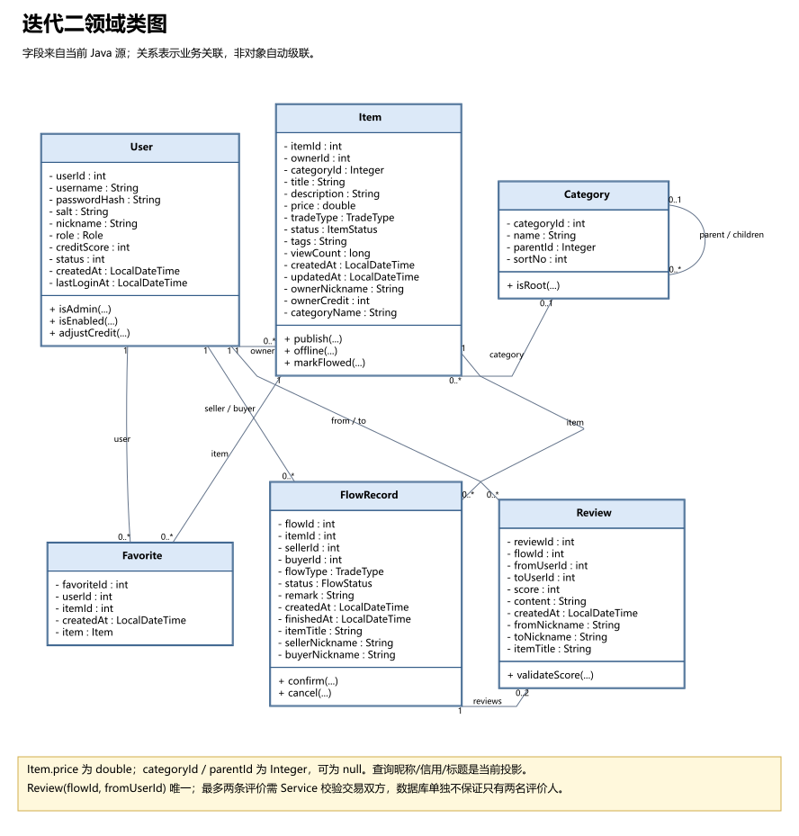
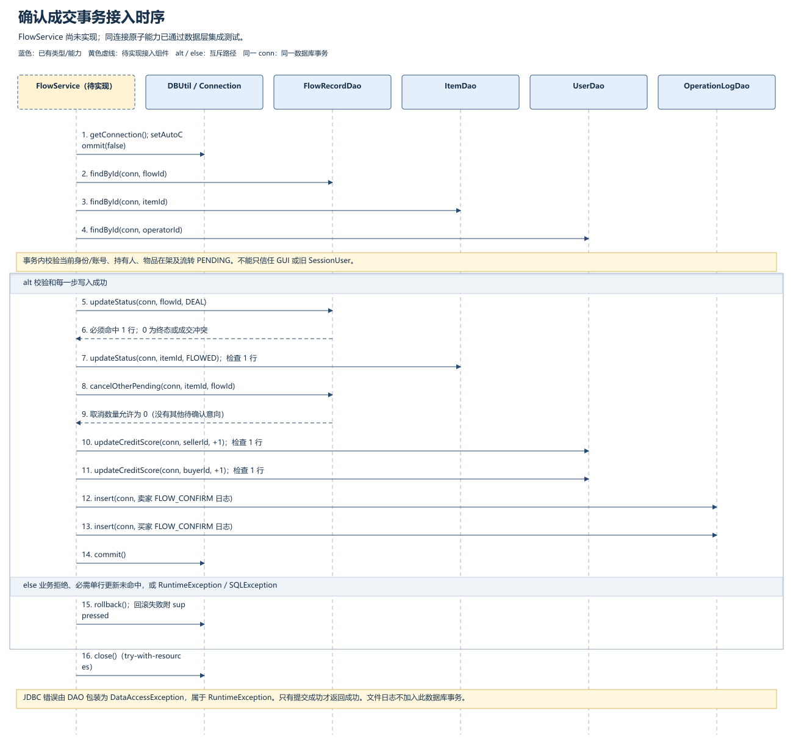

# 迭代二设计图与接口说明

本补充材料对齐模块一至十二的 Java 实现，源码基线为 `1b3ae6f`。迭代一 Word 与原 PNG 保留为历史版本，本目录是迭代二的设计入口。
类图描述现有类型；六张时序图描述后续 Service 应如何调用已有 DAO/工具。黄色虚线框均是**尚未实现的接入组件**，不能据图宣称业务或 GUI 已完成。

## 图册

| 图 | 内容 | 预览 | 可编辑源 |
| --- | --- | --- | --- |
| 01 | 领域实体、类型与多重性 | [SVG](01-domain.svg) / [PNG](01-domain.png) | [Mermaid](01-domain.mmd) / [DOT](01-domain.dot) |
| 02 | 九 DAO、实现模式、连接工厂、查询与排序 | [SVG](02-data-access.svg) / [PNG](02-data-access.png) | [Mermaid](02-data-access.mmd) / [DOT](02-data-access.dot) |
| 03 | 会话、配置、统计值、异常与文件工具 | [SVG](03-shared.svg) / [PNG](03-shared.png) | [Mermaid](03-shared.mmd) / [DOT](03-shared.dot) |
| 04 | 登录校验与登录时间/业务日志事务 | [SVG](04-login.svg) / [PNG](04-login.png) | [Mermaid](04-login.mmd) / [时序模型](04-login.sequence.json) |
| 05 | 组合检索、排序、计数与分页 | [SVG](05-search.svg) / [PNG](05-search.png) | [Mermaid](05-search.mmd) / [时序模型](05-search.sequence.json) |
| 06 | 成交、取消其他意向、双方信用与双日志 | [SVG](06-deal.svg) / [PNG](06-deal.png) | [Mermaid](06-deal.mmd) / [时序模型](06-deal.sequence.json) |
| 07 | 评价资格、唯一约束与接收人信用 | [SVG](07-review.svg) / [PNG](07-review.png) | [Mermaid](07-review.mmd) / [时序模型](07-review.sequence.json) |
| 08 | 同快照统计/配置与独立 CSV 文件导出 | [SVG](08-stat-export.svg) / [PNG](08-stat-export.png) | [Mermaid](08-stat-export.mmd) / [时序模型](08-stat-export.sequence.json) |
| 09 | 管理员下架、事务日志与运行日志边界 | [SVG](09-admin-offline.svg) / [PNG](09-admin-offline.png) | [Mermaid](09-admin-offline.mmd) / [时序模型](09-admin-offline.sequence.json) |
| 10 | ItemStatus 与 FlowStatus 状态方向 | [SVG](10-state.svg) / [PNG](10-state.png) | [Mermaid](10-state.mmd) / [DOT](10-state.dot) |

类图为阅读性省略多数 getter/setter 与重复连接重载，方法后的 `...` 表示参数省略，不能据此当作零参数签名。图 02 以真实 UserDaoImpl 展示实现模式，其他八个实现类的完整对应关系见 [DAO 清单](dao-api.md)。
类型完整实例字段见 [实体字段清单](entity-fields.md)，精确方法参数、返回类型、异常声明见 [112 个 DAO 方法](dao-api.md)。类图中的 final 是字段不能重新赋值，不代表被引用的可变实体自动深拷贝。

## 关键更正

| 迭代一材料与实现之间的差异 | 迭代二说明 |
| --- | --- |
| 旧 PNG 将 Item.price 写成 BigDecimal | 当前字段及查询价格为 double/Double，沿用 REAL 表结构；金额展示格式由界面负责 |
| 旧图分类编号为 int，物品必须有一个分类 | parentId/categoryId 为 Integer；物品可无分类，分类关系为 0..1 |
| 旧图一条流转最多一条评价 | 业务期望双方各一次，即 0..2；实际 DDL 仅唯一约束 `(flow_id, from_user_id)`，参与人和上限需 Service 保证 |
| 旧图未体现卖家/买家、评价发出/接收人的双角色 | 字段与关系明确双角色；每条记录引用对应用户，禁止自流转/自评由实体与表约束辅助 |
| 旧设计只列普通 DAO，事务模板又传 conn | 九接口现有 56 普通 + 56 Connection 重载，所有重载成对核对 |
| 旧模板只 catch SQLException，再恢复 autoCommit | 必须 catch RuntimeException 或 SQLException 并 rollback；DAO 的 DataAccessException 是非受检异常，不在失败后恢复自动提交 |
| 旧成交图未完整表现取消其他意向及信用位置 | 成交状态、物品状态、其他意向取消、双方各 +1、双方各一条日志同事务；必需单行状态/信用更新应命中 1 行，取消其他意向允许 0 行 |
| 旧评价事务写“更新双方信用” | 每条评价只影响接收人，4–5 星 +2、1–2 星 -3、3 星不变；成交的双方 +1 属于成交事务 |
| 原模型缺少本轮公共值对象与工具 | 补充 SessionUser、SysConfig、统计范围/计数、公共异常、CsvExporter、AppLogger 等 |

以上是当前实现与接入设计说明，没有替小组三方确认新接口或修改原冻结 Service 签名。接口增补与待确认项详见 [接口变更与交接](interface-changes.md)。

## 时序图的适用边界

六张业务时序均为接入设计，现有仓库没有 UserService/FlowService/ReviewService/StatService/AdminService 或 GUI 实现。原设计中的业务入口名称仅用于沟通，不代表本轮新增了这些接口代码。
alt 与 else 表示互斥路径；成功分支展示完整顺序，失败分支展示从已执行步骤失败处进入统一回滚。事务中的查找、校验、状态写入和日志写入均必须受同一个 try/catch 覆盖，而不只是最后 commit。
DBUtil.getConnection 返回前可能执行首次空库初始化，已有库不重跑清库脚本。普通 DAO 方法自己打开/关闭连接；图中传入的 conn 必须由 Service 统一关闭。

业务校验至少包括当前账号/权限、流转参与人、在架/终态、评分及七天窗口；SessionUser 是可能过时的快照，不能当作授权凭证。登录事务内重新读取账号，生成当前安全快照；凭据被并发替换时也须重新校验或拒绝本次登录，图中不构成已实现的并发认证策略。
重复意向/评价最终依赖条件 SQL/唯一约束，exists 查询仅辅助提示。ItemDao.updateStatus 不提供完整业务状态机，图 10 的 ItemStatus 守卫来自实体方法，Service 持久化前仍须校验。
成交事务中应检查流转状态、物品状态和双方信用等必需单行更新的行数；`cancelOtherPending` 返回的是实际取消数量，0 表示没有其他待确认意向，不能因此回滚合法成交。

图 08 保留当前统计语义：分类不重复汇总父级、无分类组按数据出现；物品按创建时间，终态流转按完成时间（缺失时回退创建时间）；用户卡片为当前快照。月份接口单次仅返回指定年份的十二个月，跨年报表需 Service 逐年调用并合并；未指定日期时的展示年份由后续报表产品约定。详细口径仍以 [统计模块说明](../../development/iteration2-module7.md) 为准。
CSV 接收报表选出的二维数据，不能自动读数据库或计算减碳。运行日志发生 I/O 失败时不能覆盖原业务异常，也不能把已提交业务误报成回滚；它不是数据库 operation_log 的替代物。

## 维护说明

权威编辑入口为 [图模型](diagram-model.mjs)。现有类图字段与 DAO 签名在交付时由本地工具从 Java 源提取；时序消息由图模型维护，需人工核对业务语义。图模型、Mermaid/DOT/JSON 可编辑源及 SVG/PNG 成品继续保留。

按用户要求，生成与检查脚本现仅保留在本地，不再随 GitHub 仓库分发。后续修改 Java 接口时，需同步核对接口清单、字段、图模型与预览，不能仅依赖已有图册或摘要判断仍然一致。项目编译、测试、打包和运行不依赖这些文档脚本。

在本机使用 Codex 已配置的依赖运行 Graphviz WASM 渲染类图/状态图，按同一时序模型输出 SVG，再用 sharp 生成 PNG；不增加 Maven 依赖或联网安装。
Mermaid 为便于其他编辑器预览的兼容源；本机渲染使用 DOT/时序模型，未单独运行 Mermaid 引擎，不能把 Graphviz 渲染成功当作 Mermaid 引擎兼容性测试。
历史本地检查覆盖九接口与其实现/工厂映射、成对连接重载、模型类型/方法引用、时序参与者与分支配对、生成文本及预览存在性。这些记录不是 Java 编译或业务测试，也不能自动证明后续修改的时序规则或图像布局正确。
[manifest.json](manifest.json) 记录源码基线、源内容摘要和图清单，便于发现图与代码不同步。
